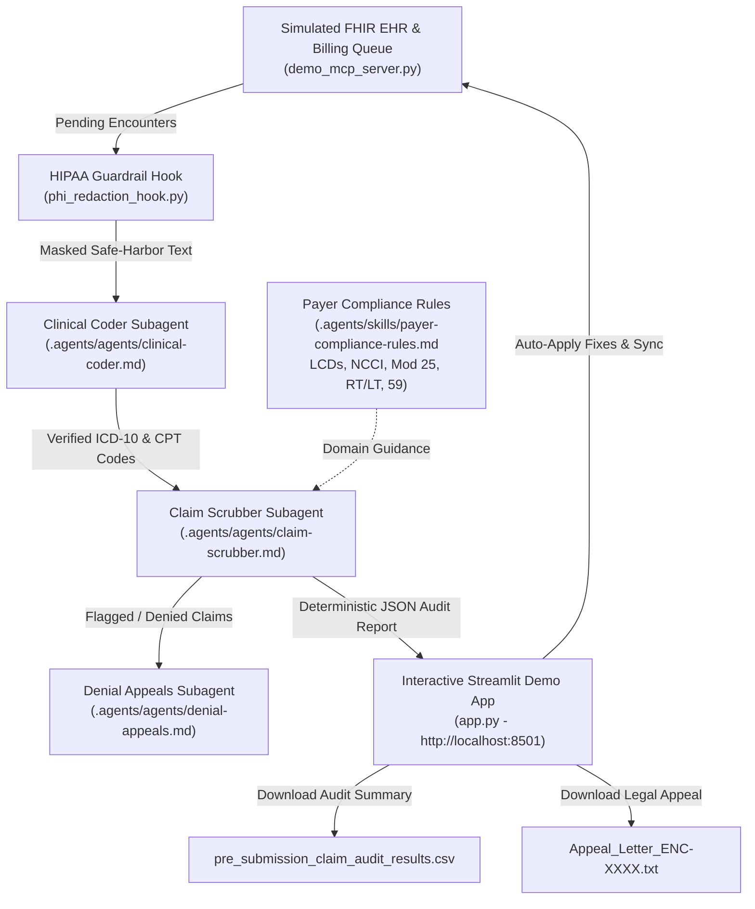

# Healthcare Revenue Cycle Management (RCM) AI Agent & Interactive Demo Application

An enterprise-grade, HIPAA-compliant Multi-Agent Healthcare Operations and Pre-Submission Claim Scrubbing System paired with an interactive **Streamlit** Web Application.

---

## 1. System Architecture



### Components

1. **`.agents/skills/payer-compliance-rules.md`**: Authoritative domain knowledge base:
   - CMS Medicare Claims Processing Manual (Chapters 12 & 23).
   - **Modifier 25 rules** for significant, separately identifiable E/M services on the same day as minor procedures or diagnostic imaging.
   - **Anatomical laterality rules** (`-RT`, `-LT`, `-50`) on paired joints and musculoskeletal imaging (CPT 73721 Knee MRI).
   - **NCCI Procedure-to-Procedure (PTP) bundling edits**: Bundling of routine venipuncture (`36415`) into preventive medicine visits (`99396`).
   - **LCD / NCD Medical Necessity crosswalks**:
     - CPT `93306` (Transthoracic Echocardiogram) covered for chest pain (`R07.9`) and dyspnea (`R06.02`).
     - CPT `70551` (Brain MRI) non-covered for uncomplicated tension headache (`G44.209`).

2. **`.agents/agents/clinical-coder.md`**: Subagent translating unstructured physician SOAP notes into ICD-10-CM and CPT/HCPCS codes with Medical Decision Making (MDM) complexity.

3. **`.agents/agents/claim-scrubber.md`**: Subagent linked to `payer-compliance-rules` auditing claims against payer edits, calculating quantitative denial risk scores (0–100), and prescribing remediation steps.

4. **`.agents/agents/denial-appeals.md`**: Subagent that synthesizes clinical evidence and regulatory citations to draft formal Level 1 Redetermination appeal letters.

5. **`phi_redaction_hook.py`**: Synchronous pre-tool execution hook de-identifying all 18 HIPAA Safe Harbor identifiers (`Name`, `SSN`, `DOB`, `MRN`, `Phone`, `Email`).

6. **`demo_mcp_server.py`**: FastMCP EHR server managing 4 realistic clinical encounters and policy lookups.

7. **`app.py`**: Interactive full-stack Streamlit web application.

8. **`run_agent.py`**: CLI orchestrator executing the multi-agent pipeline.

---

## 2. Synthetic Scenarios & Compliance Audit Matrix

| Encounter ID | Patient & Payer | Scenario & Audit Outcome | Denial Risk | Flagged Issue & Policy | Recommended Remediation |
| :--- | :--- | :--- | :--- | :--- | :--- |
| **`ENC-1001`** | Harold Finch<br>*(Medicare Adv)* | **HOLD FOR REVIEW** | **80 / 100** | • `MISSING_MODIFIER_25` on E/M `99214`<br>• `MISSING_LATERALITY` (`-RT`) on CPT `73721` | • Append Modifier 25 (`99214-25`)<br>• Append `-RT` (`73721-RT`) |
| **`ENC-1002`** | Eleanor Vance<br>*(Aetna Choice)* | **CLEAN** | **4 / 100** | *None* — TTE (`93306`) supported by chest pain (`R07.9`) under LCD-ECHOCARDIOGRAPHY | Approved for ASC X12 837P transmission |
| **`ENC-1003`** | Arthur Dent<br>*(UnitedHealthcare)* | **HOLD FOR REVIEW** | **95 / 100** | • `MEDICAL_NECESSITY_MISMATCH` — Brain MRI (`70551`) non-covered for tension headache (`G44.209`) | Hold pre-submission; remove `70551` or obtain clinical addendum with qualifying red flags |
| **`ENC-1004`** | Beatrice Smith<br>*(Cigna POS)* | **HOLD FOR REVIEW** | **80 / 100** | • `NCCI_BUNDLING` — Routine venipuncture (`36415`) bundled into preventive visit (`99396`) | Remove unbundled code `36415` or document distinct site with Modifier 59 |

---

## 3. Quick Start & Execution

### 1. Install Dependencies
```bash
pip install -r requirements.txt
```

### 2. Launch the Streamlit Web Application
```bash
streamlit run app.py --server.port 8501
```
Open **[http://localhost:8501](http://localhost:8501)** in your browser.

### 3. Run Self-Tests & CLI Orchestrator
```bash
# Test FastMCP EHR Server
python3 demo_mcp_server.py --test

# Test HIPAA PHI Redaction Hook
python3 phi_redaction_hook.py --test

# Run CLI Multi-Agent Orchestrator
python3 run_agent.py
```

---

## 4. Web Application Features (`app.py`)

- **Top Executive KPIs:** Real-time metrics tracking Pending Queue, Catch Rate, Revenue Protected ($), and HIPAA Guardrail status.
- **Tab 1 — Single Claim Scrubber & Live Trace:**
  - Encounter inspector showing physician SOAP note and draft claim payload.
  - Live execution trace (HIPAA Masking -> `clinical-coder` -> `claim-scrubber`).
  - Risk gauge, issue citations, and **1-Click "Auto-Apply Fixes & Re-Scrub" button**.
- **Tab 2 — Batch Queue Audit & CSV Export:**
  - Bulk audits all claims simultaneously.
  - One-click CSV download (`pre_submission_claim_audit_results.csv`).
- **Tab 3 — AI Denial Appeal Letter Generator:**
  - Generates formal Level 1 Redetermination appeal letters citing clinical evidence, LCDs, and NCCI policies.
  - Instant `.txt` letter download.
